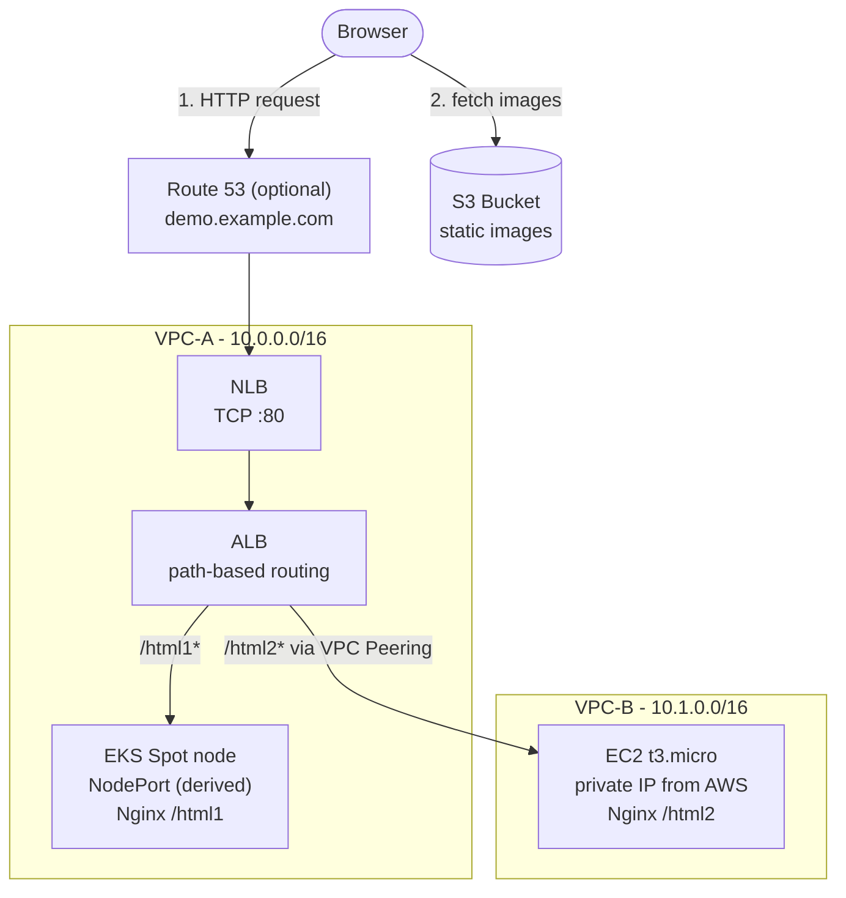

# AWS Multi-VPC Hybrid Demo (EKS + EC2) with Terraform

[](https://www.terraform.io/)
[](https://aws.amazon.com/)
[](LICENSE)

A low-cost, reproducible reference architecture that serves **two backends living in two different VPCs** behind a single entry point, using **NLB → ALB → path-based routing**, **VPC Peering** and **Security Group chaining**. It is also a small model of a platform team: developers describe what they want in one `values.yaml`, and the platform builds the rest.

The demo declares two backends:

- `/html1` → Nginx running on **Amazon EKS** (VPC-A, Spot node)
- `/html2` → Nginx running on **Amazon EC2** (VPC-B, reached over VPC Peering)

You can declare more of each kind, and an EKS workload can run your own container image.

## What is in it

- **Self-service configuration.** Developers declare workloads, instances and routes in `values.yaml`. Security group rules, NodePorts and ALB rules are derived, and mistakes are rejected by a JSON Schema and by Terraform checks, with the file and line shown on the pull request.
- **Layered Terraform.** Four layers (`network`, `compute`, `workloads`, `edge`), each with its own state, hand values to the next one through SSM parameters. A new environment is a folder with a `values.yaml`.
- **CI/CD without long-lived keys.** GitHub Actions gets short-lived credentials through OIDC. Pull requests run format, schema, validate, tflint and tfsec checks and post the plan; apply and destroy are manual and need the approval of a GitHub environment.
- **Low cost.** No NAT Gateway and no Transit Gateway: about US$0.2 per hour while it runs, and it is created and destroyed in minutes.

---

## Architecture



**Request flow**

1. The browser reaches the NLB. With a domain, `demo.<your-domain>` resolves through a Route 53 alias record that points to the NLB; without a domain, use the NLB's own DNS name (see the `nlb_dns_name` output).
2. The NLB forwards TCP :80 to the ALB (an `alb`-type target group).
3. The ALB inspects the URL path and routes to the matching target group:
   - `/html1*` → EKS worker node on the NodePort of that backend
   - `/html2*` → the EC2 instance of that backend in VPC-B (its private IP), over the VPC Peering connection
   - anything else → fixed `404` response
4. Each page loads its image directly from S3.

---

## Prerequisites

- [Terraform](https://developer.hashicorp.com/terraform/install) `>= 1.10`
- [AWS CLI](https://aws.amazon.com/cli/) (also used by the Kubernetes provider to fetch EKS tokens) configured with credentials that can create VPC, EC2, EKS, ELB, S3, IAM, and Route 53 resources
- [kubectl](https://kubernetes.io/docs/tasks/tools/) (optional, for inspecting the cluster)
- *(Optional)* A **Route 53 hosted zone** for a domain you own. Without one, the demo is reached through the NLB DNS name.

---

## Quick Start

```bash
# 1. Clone
git clone https://github.com/<your-username>/demo_tf_for_aws.git
cd demo_tf_for_aws

# 2. (One time) create the state bucket and CI roles
cd bootstrap
terraform init
terraform apply -var="github_repo=<your-username>/demo_tf_for_aws"
# note the outputs: state_bucket_name, plan_role_arn, apply_role_arn

# 3. Put the bucket name into common.state_bucket of envs/demo/values.yaml, then deploy
cd ..
cp layers/compute/terraform.tfvars.example layers/compute/terraform.tfvars   # edit eks_admin_principal_arns
cp layers/edge/terraform.tfvars.example layers/edge/terraform.tfvars         # optional: domain_name
make apply-all   # network -> compute -> workloads -> edge (plans and applies each layer)

# 4. Open the URLs that the edge layer prints, then tear it down when you are done
make output LAYER=edge
make destroy-all
```

> **Note:** set `eks_admin_principal_arns` to your own IAM user/role ARN when running locally, otherwise nobody has cluster-admin on the EKS cluster and the Kubernetes resources cannot be created.

If the CI login fails with `Not authorized to perform sts:AssumeRoleWithWebIdentity`, see the note on immutable OIDC subjects in [CI/CD](docs/ci-cd.md#one-time-setup). More commands, how to verify a deployment and what it costs are in [Operations](docs/operations.md).

---

## Documentation

| Page | What is in it |
|---|---|
| [Architecture details](docs/architecture.md) | Design decisions, network plan, security model and limitations |
| [Layers and state](docs/layers-and-state.md) | Repository layout, the four layers, remote state and how layers share values |
| [Configuration](docs/configuration.md) | `values.yaml`: workloads, instances, routes, EC2 image templates and environments |
| [CI/CD](docs/ci-cd.md) | Workflows, one-time setup, the security model of the pipeline and the path to a least-privilege apply role |
| [Operations](docs/operations.md) | Makefile commands, verifying a deployment, cost estimate and cleanup |
| [Planned architecture changes](docs/roadmap.md) | What is done, what is next and the deliberate shortcuts of the demo |

## Limitations at a glance

This is a **learning / demo environment**, not a production blueprint: HTTP only, public subnets instead of a NAT Gateway, a public EKS API endpoint (every request still needs an IAM identity with an EKS access entry), a broad CI apply role (only jobs approved in the `production` environment can assume it) and a single maintainer. The reasons and the production patterns are in [Architecture details](docs/architecture.md#limitations) and [Planned architecture changes](docs/roadmap.md).

---

## License

Released under the [MIT License](LICENSE).
