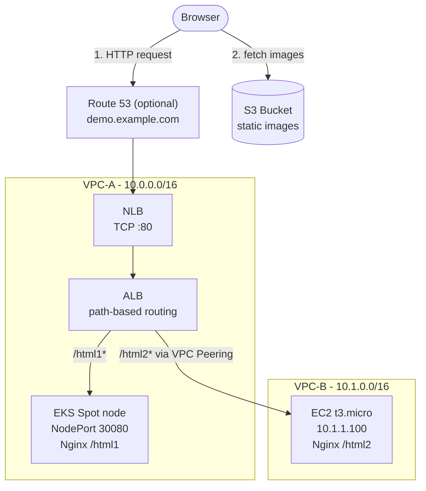
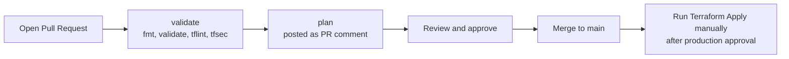

# AWS Multi-VPC Hybrid Demo (EKS + EC2) with Terraform

[](https://www.terraform.io/)
[](https://aws.amazon.com/)
[](LICENSE)

A low-cost, reproducible reference architecture that serves **two backends living in two different VPCs** behind a single entry point, using **NLB → ALB → path-based routing**, **VPC Peering**, and **Security Group chaining**.

- `/html1` → Nginx running on **Amazon EKS** (VPC-A, Spot node)
- `/html2` → Nginx running on **Amazon EC2** (VPC-B, reached over VPC Peering)

Everything is provisioned with Terraform and can be created and destroyed in minutes. No NAT Gateway and no Transit Gateway, so a 2-hour test costs well under a dollar.

---

## Table of Contents

- [Architecture](#architecture)
- [Key Design Decisions](#key-design-decisions)
- [Network Plan](#network-plan)
- [Security Model](#security-model)
- [Repository Layout](#repository-layout)
- [Prerequisites](#prerequisites)
- [Quick Start](#quick-start)
- [Configuration](#configuration)
- [Remote State](#remote-state)
- [CI/CD](#cicd)
- [Cost Estimate](#cost-estimate)
- [Limitations](#limitations)
- [Cleanup](#cleanup)
- [Roadmap](#roadmap)
- [Contributing](#contributing)
- [License](#license)

---

## Architecture



**Request flow**

1. The browser reaches the NLB. With a domain, `demo.<your-domain>` resolves through a Route 53 alias record that points to the NLB; without a domain, use the NLB's own DNS name (see the `nlb_dns_name` output).
2. The NLB forwards TCP :80 to the ALB (an `alb`-type target group).
3. The ALB inspects the URL path and routes to the matching target group:
   - `/html1*` → EKS worker node on NodePort `30080`
   - `/html2*` → EC2 instance at `10.1.1.100` in VPC-B, over the VPC Peering connection
   - anything else → fixed `404` response
4. Each page loads its image directly from S3.

---

## Key Design Decisions

| Decision | Why |
|---|---|
| **No NAT Gateway / Transit Gateway** | NAT Gateway and TGW are billed hourly plus per GB. Public subnets with locked-down Security Groups plus VPC Peering (free) keep the demo cheap. |
| **NLB in front of ALB** | Gives a static entry point (L4) while keeping L7 path routing on the ALB. |
| **Internal ALB** | The ALB only has private IPs and is reachable only through the NLB. Set `internal = false` in the `alb` module to make it internet-facing. |
| **ALB with `instance` target for EKS** | The Node Group's Auto Scaling Group is attached directly to the target group. This avoids installing the AWS Load Balancer Controller for a demo. |
| **ALB with `ip` target for EC2** | Allows the ALB in VPC-A to target a private IP in the peered VPC-B. |
| **Spot instances for EKS nodes** | Lowest-cost compute for a short-lived environment. |
| **Modules + environments layout** | Reusable modules, with each environment composing them. Adding `staging` is a copy-and-edit operation. |

---

## Network Plan

| Component | CIDR / IP | AZ | Purpose |
|---|---|---|---|
| **VPC-A** | `10.0.0.0/16` | - | Entry layer (NLB, ALB) and EKS |
| ├ `vpc-a-public-1` | `10.0.1.0/24` | 1st AZ of the region | ALB/NLB node, EKS Spot node |
| └ `vpc-a-public-2` | `10.0.2.0/24` | 2nd AZ of the region | ALB/NLB node (ALB requires 2 AZs) |
| **VPC-B** | `10.1.0.0/16` | - | Standalone EC2 workload |
| └ `vpc-b-public-1` | `10.1.1.0/24` | 1st AZ of the region | EC2 with fixed IP `10.1.1.100` |
| **VPC Peering** | - | - | A route table: `10.1.0.0/16 → pcx`; B route table: `10.0.0.0/16 → pcx` |

The two CIDR blocks do not overlap, which is required for VPC Peering.

Subnet CIDRs are derived from the VPC CIDRs (`/16` → `/24`). The AZs are the first two available AZs of the region, sorted by name (in `ap-northeast-1` that is `ap-northeast-1a` and `ap-northeast-1c`), so the table stays valid when you change `region`.

---

## Security Model

EKS nodes and the EC2 instance sit in public subnets (they need outbound internet to pull images and packages without a NAT Gateway). Inbound access is therefore locked down with chained Security Groups so that **the only way in is through the load balancer**.

| Security Group | Attached to | Inbound | Outbound |
|---|---|---|---|
| `alb-sg` | ALB | `0.0.0.0/0` → TCP 80 | EKS nodes, `10.1.0.0/16` |
| `eks-node-sg` | EKS worker nodes | **Only** `alb-sg` → TCP 30080 | All |
| `ec2-sg` | VPC-B EC2 | **Only** `10.0.0.0/16` → TCP 80 | All |

Direct requests to a node's or the EC2 instance's public IP are dropped.

---

## Repository Layout

```
aws-multi-vpc-terraform/
├── README.md
├── LICENSE
├── .gitignore
├── Makefile                  # make help lists all targets
├── .github/
│   └── workflows/
│       ├── terraform-plan.yml      # on PR: checks + plan comment
│       ├── terraform-apply.yml     # manual: apply
│       └── terraform-destroy.yml   # manual: tear everything down
├── assets/                   # images uploaded to S3 by Terraform
│   ├── eks-logo.png
│   └── ec2-logo.png
├── bootstrap/                # one-time: state bucket + GitHub OIDC roles
├── modules/                  # reusable building blocks
│   ├── vpc/
│   ├── vpc-peering/
│   ├── security-groups/
│   ├── s3-assets/
│   ├── ec2-nginx/
│   ├── eks/
│   ├── k8s-nginx/
│   ├── alb/
│   ├── nlb/
│   └── dns/
└── envs/
    └── demo/                 # run Terraform from here
        ├── backend.tf
        ├── versions.tf
        ├── providers.tf
        ├── main.tf
        ├── variables.tf
        ├── locals.tf
        ├── outputs.tf
        └── terraform.tfvars.example
```

---

## Prerequisites

- [Terraform](https://developer.hashicorp.com/terraform/install) `>= 1.10`
- [AWS CLI](https://aws.amazon.com/cli/) (also used by the Kubernetes provider to fetch EKS tokens) configured with credentials that can create VPC, EC2, EKS, ELB, S3, IAM, and Route 53 resources
- [kubectl](https://kubernetes.io/docs/tasks/tools/) (optional, for inspecting the cluster)
- *(Optional)* A **Route 53 hosted zone** for a domain you own. Without one, the demo is reached through the NLB DNS name.

---

## Quick Start

```bash
# 1. Clone
git clone https://github.com/<your-username>/aws-multi-vpc-terraform.git
cd aws-multi-vpc-terraform

# 2. (One time) create the state bucket and CI roles
cd bootstrap
terraform init
terraform apply -var="github_repo=<your-username>/aws-multi-vpc-terraform"
# note the outputs: state_bucket_name, plan_role_arn, apply_role_arn

# 3. Put the bucket name into envs/demo/backend.tf, then deploy
cd ../envs/demo
cp terraform.tfvars.example terraform.tfvars   # edit eks_admin_principal_arns (and domain_name if you have one)
terraform init
terraform plan
terraform apply
```

> **Note:** set `eks_admin_principal_arns` to your own IAM user/role ARN when running locally, otherwise nobody has cluster-admin on the EKS cluster and the Kubernetes resources cannot be created.

> **Tip:** a single `terraform apply` normally works. If the first `apply` fails because the Kubernetes provider cannot reach the cluster yet, re-run it, or run
> `terraform apply -target=module.eks` first and then a full `terraform apply`.

### Makefile shortcuts

The Makefile wraps the common commands. Run `make help` to list them. The environment defaults to `ENV=demo` (override with `make plan ENV=staging`).

| Command | What it does |
|---|---|
| `make bootstrap GITHUB_REPO=owner/repo` | One time: create the state bucket and CI roles |
| `make fmt` / `make fmt-check` | Format Terraform files / check formatting (same as CI) |
| `make validate` | `init -backend=false` and `validate`; no AWS credentials needed |
| `make lint` | Run `tflint` on all modules |
| `make init` | Initialize the environment with the S3 backend |
| `make plan` | Create an execution plan, saved as `tfplan` |
| `make apply` | Run `plan`, then apply the saved plan |
| `make destroy` | Destroy the environment (asks for confirmation) |
| `make output` | Show outputs (demo URLs) |
| `make clean` | Remove `.terraform/` caches and saved plans |

### Verify

```bash
# <host> is demo.<your-domain>, or the NLB DNS name if you did not set domain_name
curl http://<host>/html1   # Hello from EKS (VPC-A)
curl http://<host>/html2   # Hello from EC2 (VPC-B via VPC Peering)
curl http://<host>/        # 404 with usage hint
```

Terraform also prints the URLs as outputs. With a domain:

```
demo_url_eks = "http://demo.example.com/html1"
demo_url_ec2 = "http://demo.example.com/html2"
```

Without a domain, the host is the NLB DNS name (for example `demo-nlb-1234567890.elb.ap-northeast-1.amazonaws.com`).

---

## Configuration

Set these in `envs/demo/terraform.tfvars`:

| Variable | Default | Description |
|---|---|---|
| `region` | `ap-northeast-1` | AWS region |
| `domain_name` | `""` | Existing public Route 53 hosted zone, e.g. `example.com`. Empty = no DNS record; use the NLB DNS name |
| `record_name` | `demo` | Subdomain for the demo (`demo.example.com`). Only used when `domain_name` is set |
| `name` | `demo` | Name prefix for resources (1-20 chars: lowercase letters, digits, hyphens) |
| `vpc_a_cidr` | `10.0.0.0/16` | CIDR of VPC-A |
| `vpc_b_cidr` | `10.1.0.0/16` | CIDR of VPC-B |
| `ec2_private_ip` | `null` | Fixed private IP of the EC2 instance. `null` = the `.100` address of the VPC-B subnet (`10.1.1.100`) |
| `node_port` | `30080` | Kubernetes NodePort between the ALB and the EKS nodes |
| `kubernetes_version` | `null` | EKS version. `null` = the EKS default for new clusters |
| `eks_admin_principal_arns` | `[]` | IAM users/roles with cluster-admin on EKS for local runs (the CI apply role is added automatically) |
| `ci_plan_role_arn` | `""` | CI plan role (read-only EKS access). Set by CI from `AWS_PLAN_ROLE_ARN` |
| `ci_apply_role_arn` | `""` | CI apply role (EKS admin). Set by CI from `AWS_APPLY_ROLE_ARN` |

`domain_name` is optional. Set it to create the Route 53 alias record; leave it empty to skip DNS.

---

## Remote State

Terraform state is stored in an **S3 bucket** (created by `bootstrap/`), never in Git.

| Feature | Setting |
|---|---|
| Versioning | Enabled (old versions expire after 90 days) |
| Encryption | SSE-S3 (AES256) |
| Public access | Fully blocked; plain HTTP requests denied |
| Locking | S3 native locking (`use_lockfile = true`, Terraform >= 1.10), no DynamoDB needed |

> State files can contain secrets in plain text and Git has no locking, so committing `terraform.tfstate` is unsafe.
> The provided `.gitignore` should exclude `*.tfstate*`, `.terraform/`, and `terraform.tfvars`.

---

## CI/CD

Infrastructure changes go through a pull request. GitHub Actions authenticates to AWS with **OIDC**, so no long-lived AWS keys are stored in GitHub.



| Workflow | Trigger | What it does |
|---|---|---|
| `terraform-plan.yml` | Pull request to `main` | Runs `fmt -check`, `validate`, `tflint`, `tfsec`, then `terraform plan` and posts (or updates) the plan as a PR comment. Uses the read-only **plan role**. |
| `terraform-apply.yml` | Manual (`workflow_dispatch`) | Runs `terraform plan` then `terraform apply` in the `production` environment. Must run from `main` and needs `production` approval. Merging does not deploy. Uses the **apply role**. |
| `terraform-destroy.yml` | Manual (`workflow_dispatch`) | Destroys the demo environment. Requires typing `destroy`, running from `main`, and `production` approval. |

### One-time setup

1. Run `bootstrap/` locally (see [Quick Start](#quick-start)) and note the three outputs.
2. In **Settings → Secrets and variables → Actions → Variables**, add:

   | Variable | Value |
   |---|---|
   | `AWS_REGION` | e.g. `ap-northeast-1` |
   | `DOMAIN_NAME` | *(optional)* your Route 53 zone, e.g. `example.com` |
   | `RECORD_NAME` | *(optional)* e.g. `demo` (defaults to `demo`) |
   | `AWS_PLAN_ROLE_ARN` | `plan_role_arn` output |
   | `AWS_APPLY_ROLE_ARN` | `apply_role_arn` output |

3. In **Settings → Environments**, create `production`, add **Required reviewers**, and restrict **Deployment branches** to `main`.
4. In **Settings → Branches**, protect `main`: require a pull request, require the `validate` and `plan` checks to pass, and block direct pushes.

### Security model

- The **plan role** can only be assumed by `pull_request` jobs and has read-only access plus state access.
- The **apply role** can only be assumed by jobs running in the `production` environment.
- The demo apply role uses `AdministratorAccess` for simplicity. Replace it with a least-privilege policy for real use.
- Plan comments only work for pull requests from the same repository (forks do not receive OIDC tokens).

### Known caveats

- **First deployment:** the Kubernetes provider is configured from the EKS cluster, which does not exist yet on the first run. A single `terraform apply` normally works; if it fails on the Kubernetes resources, re-run it, or run `terraform apply -target=module.eks` first.
- **Reading Kubernetes resources in `plan`:** once the cluster exists, grant the plan role read access via an EKS access entry (`AmazonEKSViewPolicy`), otherwise `plan` fails on Kubernetes resources.
- **Apply re-plans:** `apply` runs a fresh plan when you trigger it, so the result can differ from the PR comment if the infrastructure changed in between.
- **Drift between `main` and AWS:** because apply is manual, merged changes are not deployed until you run the workflow.

---

## Cost Estimate

Approximate, for `ap-northeast-1`, on-demand and Spot prices at the time of writing. Check the [AWS pricing pages](https://aws.amazon.com/pricing/) for current numbers.

| Resource | Approx. cost |
|---|---|
| EKS control plane | ~US$0.10 / hr |
| ALB | ~US$0.02 / hr + LCU |
| NLB | ~US$0.02 / hr + NLCU |
| EC2 `t3.micro` + EKS `t3.small` Spot | ~US$0.02 / hr |
| Public IPv4 addresses | ~US$0.005 / hr each |
| VPC Peering (same region) | Free (data transfer charges may apply) |
| **Total** | **~US$0.2 / hr, roughly US$0.4 for a 2-hour test** |

Remember to run `terraform destroy` when you are done. Setting up an [AWS Budget](https://docs.aws.amazon.com/cost-management/latest/userguide/budgets-managing-costs.html) alert is also recommended.

---

## Limitations

This project is a **learning / demo environment**, not a production blueprint.

- **HTTP only.** To enable HTTPS, add an ACM certificate and a port 443 listener to the ALB.
- **Public EKS API endpoint.** It is open to `0.0.0.0/0` (CI runners need it); restrict `public_access_cidrs` in the `eks` module for real use.
- **Public subnets for compute.** Chosen to avoid NAT Gateway cost. Production workloads should use private subnets.
- **Public S3 bucket** for demo images. For production, use CloudFront with Origin Access Control.
- **Spot nodes** can be reclaimed at any time.
- **Single EC2 instance in a single AZ.** No high availability for `/html2`.
- **Broad CI permissions.** The apply role uses `AdministratorAccess` for simplicity.

---

## Cleanup

**Option A: GitHub Actions (recommended)**

Go to **Actions → Terraform Destroy → Run workflow**, type `destroy`, and approve the `production` deployment.

**Option B: locally**

```bash
cd envs/demo
terraform destroy
```

**Optional: remove the state bucket and CI roles** (do this last, after the demo environment is destroyed)

```bash
# The bucket is not force-destroyed, so empty it first (including all versions)
cd bootstrap
terraform destroy -var="github_repo=<your-username>/aws-multi-vpc-terraform"
```

---

## Roadmap

- [ ] HTTPS with ACM
- [ ] Private subnets + VPC endpoints as an alternative to public subnets
- [ ] AWS Load Balancer Controller with Ingress instead of NodePort
- [ ] CloudFront in front of S3 assets
- [x] GitHub Actions: `fmt`, `validate`, `tflint`, `tfsec`, plan on PR, manual apply, manual destroy
- [ ] Make `tfsec` findings blocking
- [ ] Least-privilege policy for the apply role
- [ ] Scheduled auto-destroy for the demo environment
- [ ] Auto Scaling for the EC2 backend

---

## Contributing

Issues and pull requests are welcome. Please run `terraform fmt -recursive` and `terraform validate` before submitting.

## License

Released under the [MIT License](LICENSE).