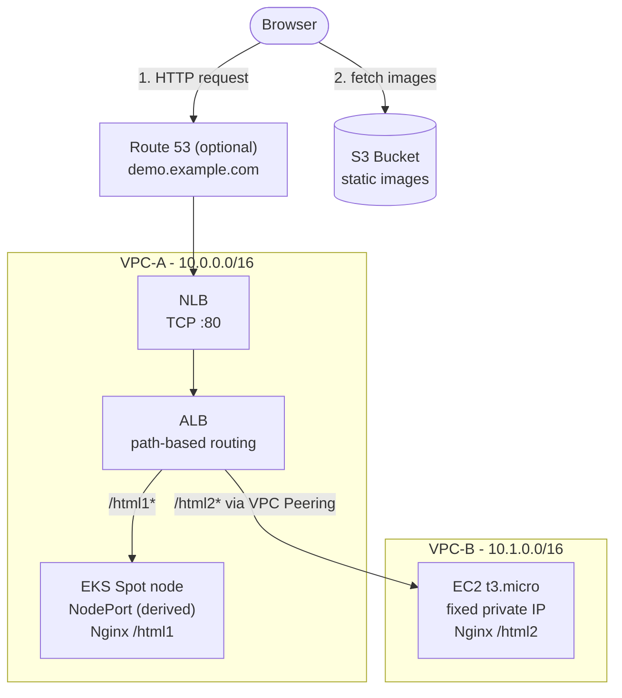
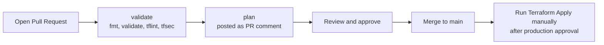

# AWS Multi-VPC Hybrid Demo (EKS + EC2) with Terraform

[](https://www.terraform.io/)
[](https://aws.amazon.com/)
[](LICENSE)

A low-cost, reproducible reference architecture that serves **two backends living in two different VPCs** behind a single entry point, using **NLB → ALB → path-based routing**, **VPC Peering**, and **Security Group chaining**.

The workloads, instances and routes are declared in `values.yaml` (see [Workloads, instances and backends](#workloads-instances-and-backends)). The demo declares two:

- `/html1` → Nginx running on **Amazon EKS** (VPC-A, Spot node)
- `/html2` → Nginx running on **Amazon EC2** (VPC-B, reached over VPC Peering)

You can declare more of each kind, and an EKS workload can run your own container image.

Everything is provisioned with Terraform and can be created and destroyed in minutes. No NAT Gateway and no Transit Gateway, so a 2-hour test costs well under a dollar.

---

## Table of Contents

- [Architecture](#architecture)
- [Key Design Decisions](#key-design-decisions)
- [Network Plan](#network-plan)
- [Security Model](#security-model)
- [Repository Layout](#repository-layout)
- [Prerequisites](#prerequisites)
- [Quick Start](#quick-start)
- [Configuration](#configuration)
- [Remote State](#remote-state)
- [CI/CD](#cicd)
- [Cost Estimate](#cost-estimate)
- [Limitations](#limitations)
- [Cleanup](#cleanup)
- [Planned Architecture Changes](#planned-architecture-changes)
- [License](#license)

---

## Architecture



**Request flow**

1. The browser reaches the NLB. With a domain, `demo.<your-domain>` resolves through a Route 53 alias record that points to the NLB; without a domain, use the NLB's own DNS name (see the `nlb_dns_name` output).
2. The NLB forwards TCP :80 to the ALB (an `alb`-type target group).
3. The ALB inspects the URL path and routes to the matching target group:
   - `/html1*` → EKS worker node on the NodePort of that backend
   - `/html2*` → the EC2 instance of that backend in VPC-B (fixed private IP), over the VPC Peering connection
   - anything else → fixed `404` response
4. Each page loads its image directly from S3.

---

## Key Design Decisions

| Decision | Why |
|---|---|
| **No NAT Gateway / Transit Gateway** | NAT Gateway and TGW are billed hourly plus per GB. Public subnets with locked-down Security Groups plus VPC Peering (free) keep the demo cheap. |
| **NLB in front of ALB** | Gives a static entry point (L4) while keeping L7 path routing on the ALB. |
| **Internal ALB** | The ALB only has private IPs and is reachable only through the NLB. Set `internal = false` in the `alb` module to make it internet-facing. |
| **ALB with `instance` target for EKS** | The Node Group's Auto Scaling Group is attached directly to the target group. This avoids installing the AWS Load Balancer Controller for a demo. |
| **ALB with `ip` target for EC2** | Allows the ALB in VPC-A to target a private IP in the peered VPC-B. |
| **Spot instances for EKS nodes** | Lowest-cost compute for a short-lived environment. |
| **Layers shared by all environments** | The Terraform code lives once in `layers/`; an environment is a folder with only a `values.yaml`. Adding `staging` means copying that folder and editing the values. |
| **Routes are separate from what runs** | `workloads`, `instances` and `backends` are different sections of `values.yaml`. A backend is only a path that leads to a workload or an instance, so one workload can have several paths, and a workload nobody routes to stays inside the cluster. |
| **Numbers are derived, not chosen** | NodePorts, EC2 private IPs and ALB priorities come from a hash of the name, so adding or removing something never changes the others. Security group rules are generated from what is routed. |
| **EC2 instances come from image templates** | An instance names a template from `templates/ec2/` (AMI and boot script) maintained by the platform team; it cannot pick an arbitrary image or script. |

---

## Network Plan

| Component | CIDR / IP | AZ | Purpose |
|---|---|---|---|
| **VPC-A** | `10.0.0.0/16` | - | Entry layer (NLB, ALB) and EKS |
| ├ `vpc-a-public-1` | `10.0.1.0/24` | 1st AZ of the region | ALB/NLB node, EKS Spot node |
| └ `vpc-a-public-2` | `10.0.2.0/24` | 2nd AZ of the region | ALB/NLB node (ALB requires 2 AZs) |
| **VPC-B** | `10.1.0.0/16` | - | Standalone EC2 workload |
| └ `vpc-b-public-1` | `10.1.1.0/24` | 1st AZ of the region | EC2 backends, each with a fixed IP in this subnet |
| **VPC Peering** | - | - | A route table: `10.1.0.0/16 → pcx`; B route table: `10.0.0.0/16 → pcx` |

The two CIDR blocks do not overlap, which is required for VPC Peering.

Subnet CIDRs are derived from the VPC CIDRs (`/16` → `/24`). The AZs are the first two available AZs of the region, sorted by name (in `ap-northeast-1` that is `ap-northeast-1a` and `ap-northeast-1c`), so the table stays valid when you change `region`.

---

## Security Model

EKS nodes and the EC2 instance sit in public subnets (they need outbound internet to pull images and packages without a NAT Gateway). Inbound access is therefore locked down with chained Security Groups so that **the only way in is through the load balancer**.

| Security Group | Attached to | Inbound | Outbound |
|---|---|---|---|
| `alb-sg` | ALB | `0.0.0.0/0` → TCP 80 | EKS nodes (NodePort of each routed workload), `10.1.0.0/16` (when an instance is routed) |
| `eks-node-sg` | EKS worker nodes | **Only** `alb-sg` → the NodePort of each routed workload | All |
| `ec2-sg` | VPC-B EC2 | **Only** `10.0.0.0/16` → TCP 80 | All |

Direct requests to a node's or the EC2 instance's public IP are dropped. The rules are generated from what is routed; nobody writes them by hand.

**Why `alb-sg` accepts `0.0.0.0/0`:** the ALB is internal, so it only has private IP addresses and nothing on the internet can route to it. The only public entry point is the NLB. The rule therefore does not open the ALB to the internet: it only matters for traffic that is already inside VPC-A, or inside VPC-B through the peering. It is not limited to the VPC CIDR because the source address that the ALB sees when the NLB forwards to it (the NLB's own address or the original client's) has not been verified in this project; limiting it is a possible hardening step once that has been tested.

---

## Repository Layout

```
demo_tf_for_aws/
├── README.md
├── LICENSE
├── .gitignore
├── Makefile                  # make help lists all targets
├── .github/
│   ├── workflows/
│   │   ├── terraform-plan.yml      # on PR: checks + plan comment
│   │   ├── terraform-apply.yml     # manual: apply all layers in order
│   │   └── terraform-destroy.yml   # manual: destroy all layers in reverse order
│   └── scripts/
│       ├── plan-layers.sh          # plans every layer of one environment, skips layers whose upstream is not deployed
│       ├── apply-layer.sh          # applies one layer of one environment
│       └── destroy-layer.sh        # destroys one layer, retrying a few times
├── assets/                   # images uploaded to S3 by Terraform
│   ├── eks-logo.png
│   └── ec2-logo.png
├── bootstrap/                # one-time: state bucket + GitHub OIDC roles
├── modules/                  # reusable building blocks
│   ├── vpc/
│   ├── vpc-peering/
│   ├── security-group/       # one generic security group + rules map (used 3 times)
│   ├── s3-assets/
│   ├── ec2-instance/         # one EC2 instance created from an image template
│   ├── eks/
│   ├── k8s-app/
│   ├── alb/
│   ├── nlb/
│   ├── dns/
│   ├── ssm-publisher/        # publishes values as SSM parameters (end of a layer)
│   └── ssm-reader/           # reads what a layer before it published (start of a layer)
├── layers/                   # Terraform code of the four layers, shared by every environment
│   ├── network/              # VPCs, peering, security groups
│   ├── compute/              # S3 assets, EC2, EKS
│   ├── workloads/            # Kubernetes Deployment + Service
│   └── edge/                 # ALB, NLB, Route 53
├── templates/
│   ├── demo-page.html.tftpl  # the demo page (EKS and EC2)
│   └── ec2/                  # EC2 image templates: templates.yaml + one user data file each
├── schemas/
│   ├── values.schema.json    # JSON Schema of envs/<environment>/values.yaml
│   ├── ec2-templates.schema.json
│   └── tests/                # valid and invalid examples of the schemas
├── scripts/
│   ├── tf.sh                 # runs terraform for one environment and layer (backend + environment)
│   ├── validate-values.py    # checks values.yaml and the EC2 templates against the schemas
│   ├── test-schemas.sh       # runs the schema fixtures
│   └── requirements.txt      # Python packages of the two scripts above
└── envs/
    └── demo/                 # an environment is a folder with a values.yaml, no Terraform code
        └── values.yaml
```

Each folder under `layers/` is a complete root module with its own `backend.tf`, `versions.tf`, `variables.tf`, `values.tf` (reads `envs/<environment>/values.yaml`) and `main.tf`. `network`, `compute` and `edge` also have `providers.tf`, `locals.tf` and `outputs.tf`; `workloads` is smaller (its `providers.tf` configures the Kubernetes provider, and it has no outputs). `compute` and `edge` also declare the values that come from GitHub variables and secrets, and ship a `terraform.tfvars.example`. The layers are shared by all environments: the environment is chosen with the `environment` variable, which `scripts/tf.sh` sets (see [Environments](#environments)).

---

## Prerequisites

- [Terraform](https://developer.hashicorp.com/terraform/install) `>= 1.10`
- [AWS CLI](https://aws.amazon.com/cli/) (also used by the Kubernetes provider to fetch EKS tokens) configured with credentials that can create VPC, EC2, EKS, ELB, S3, IAM, and Route 53 resources
- [kubectl](https://kubernetes.io/docs/tasks/tools/) (optional, for inspecting the cluster)
- *(Optional)* A **Route 53 hosted zone** for a domain you own. Without one, the demo is reached through the NLB DNS name.

---

## Quick Start

```bash
# 1. Clone
git clone https://github.com/<your-username>/demo_tf_for_aws.git
cd demo_tf_for_aws

# 2. (One time) create the state bucket and CI roles
cd bootstrap
terraform init
terraform apply -var="github_repo=<your-username>/demo_tf_for_aws"
# note the outputs: state_bucket_name, plan_role_arn, apply_role_arn

# 3. Put the bucket name into common.state_bucket of envs/demo/values.yaml, then deploy
cd ..
cp layers/compute/terraform.tfvars.example layers/compute/terraform.tfvars   # edit eks_admin_principal_arns
cp layers/edge/terraform.tfvars.example layers/edge/terraform.tfvars         # optional: domain_name
make apply-all   # network -> compute -> workloads -> edge (plans and applies each layer)
```

The environment is split into four layers that are applied in this order; each layer reads what it needs from the layers before it (see [How layers share values](#how-layers-share-values)). To work on one layer only, use `make plan LAYER=network`, `make apply LAYER=network`, and so on.

> **Immutable OIDC subject:** newer GitHub repositories send an OIDC subject that includes numeric IDs (`repo:<owner>@<owner-id>/<repo>@<repo-id>`), and then the CI roles reject the login with `Not authorized to perform sts:AssumeRoleWithWebIdentity`. Check with `gh api repos/<owner>/<repo>/actions/oidc/customization/sub` and, if it shows a `sub_claim_prefix`, pass it to bootstrap:
> `terraform apply -var="github_repo=..." -var="github_oidc_subject_prefix=<sub_claim_prefix>"` (or `make bootstrap GITHUB_REPO=... OIDC_SUB_PREFIX=...`).

> **Note:** set `eks_admin_principal_arns` to your own IAM user/role ARN when running locally, otherwise nobody has cluster-admin on the EKS cluster and the Kubernetes resources cannot be created.

> **Tip:** the Kubernetes resources live in their own layer (`workloads`), which is configured from the EKS cluster created by `compute`. This is why no `-target` workaround is needed on the first deployment.

### Makefile shortcuts

The Makefile wraps the common commands. Run `make help` to list them. The environment defaults to `ENV=demo` (a folder under `envs/`). Single-layer targets take `LAYER=network|compute|workloads|edge`.

| Command | What it does |
|---|---|
| `make bootstrap GITHUB_REPO=owner/repo` | One time: create the state bucket and CI roles |
| `make fmt` / `make fmt-check` | Format Terraform files / check formatting (same as CI) |
| `make validate-values` | Check every `envs/*/values.yaml` and the EC2 templates against their JSON Schema |
| `make test-schemas` | Run the schema fixtures in `schemas/tests` |
| `make validate` | `validate-values`, then `init -backend=false` and `validate` for every layer; no AWS credentials needed |
| `make lint` | Run `tflint` on all modules |
| `make init LAYER=...` | Initialize one layer with the S3 backend |
| `make plan LAYER=...` | Create an execution plan for one layer, saved as `tfplan` |
| `make apply LAYER=...` | Run `plan`, then apply the saved plan of one layer |
| `make destroy LAYER=...` | Destroy one layer (asks for confirmation) |
| `make apply-all` | Apply all layers in order (network first) |
| `make destroy-all` | Destroy all layers in reverse order (edge first); asks per layer |
| `make output LAYER=edge` | Show the outputs of a layer (the backend URLs are in `edge`) |
| `make clean` | Remove `.terraform/` caches and saved plans |

### Verify

```bash
# <host> is demo.<your-domain>, or the NLB DNS name if you did not set domain_name
curl http://<host>/html1   # Hello from web (EKS in VPC-A)
curl http://<host>/html2   # Hello from legacy (EC2 in VPC-B via VPC Peering)
curl http://<host>/        # 404 that lists the routes
```

The `edge` layer prints the URL of each backend (keyed by backend name) as an output (`make output LAYER=edge`). With a domain:

```
backend_urls = {
  "ec2-page" = "http://demo.example.com/html2"
  "eks-page" = "http://demo.example.com/html1"
}
```

Without a domain, the host is the NLB DNS name (for example `demo-nlb-1234567890.elb.ap-northeast-1.amazonaws.com`).

---

## Configuration

Configuration comes from two places:

1. **`envs/demo/values.yaml`** holds the environment values and is shared by all layers. Each layer reads it with `yamldecode(file(...))` in its `values.tf`, and checks it with preconditions (for example the name format, valid and non-overlapping CIDRs, and the workloads, instances and backends: targets, paths, ports and IPs). A new environment is a new values file.
2. **Variables** hold the values that come from outside the repository: set them in `terraform.tfvars` inside the layer folder (see the `terraform.tfvars.example` files); in CI they come from GitHub repository variables and secrets.

**`values.yaml` is checked against a schema** (`schemas/values.schema.json`) before anything is planned: unknown or misspelled keys (for example `replica` instead of `replicas`), wrong types, values out of range, missing required fields, and a backend without exactly one target are reported with the file and line, for example `envs/demo/values.yaml:24: workloads.web: unknown key 'replica' - did you mean 'replicas'?`. This runs

- locally: `make validate-values` (needs `python3 -m pip install -r scripts/requirements.txt`),
- in CI, where each error shows up as an annotation on the pull request, and
- in the editor: both YAML files start with a `# yaml-language-server: $schema=...` line, so the [YAML extension for VS Code](https://marketplace.visualstudio.com/items?itemName=redhat.vscode-yaml) offers completion, shows the description of each field and underlines mistakes while you type. Keep that line when you copy an environment.

The schema only checks the shape. What needs other data (a backend points to an existing workload or instance, paths, NodePorts, IPs and priorities are unique, the EC2 template exists) is checked by Terraform when the network layer is planned. When a field is added to the platform, the schema changes in the same pull request.

The layers use a partial S3 backend. `scripts/tf.sh` passes the bucket, region and state key to `terraform init` with `-backend-config`, taking the bucket and region from `common.state_bucket` and `common.region`, so `values.yaml` is the only place that has them. These two keys must be written as `key: value` on one line directly under `common:`, because `scripts/common-value.sh` reads them with `awk` instead of a YAML parser (so no extra tool is needed). `make validate-values` compares that reader with a real YAML parser and fails if they disagree.

**`values.yaml`**

| Key | Default | Description |
|---|---|---|
| `common.name` | `demo` | Name prefix for resources (1-20 chars: lowercase letters, digits, hyphens) |
| `common.region` | `ap-northeast-1` | AWS region |
| `common.state_bucket` | *(bucket name)* | State bucket (the Terraform backend of every layer) |
| `common.tags` | Project, Environment, ManagedBy | Default tags on every resource; each layer adds a `Layer` tag |
| `network.vpc_a_cidr` | `10.0.0.0/16` | CIDR of VPC-A |
| `network.vpc_b_cidr` | `10.1.0.0/16` | CIDR of VPC-B (must not overlap VPC-A) |
| `common.http_port` | `80` | Port of the NLB and ALB listeners, and of Nginx on the EC2 instances |
| `compute.ec2_instance_type` | `t3.micro` | Default instance type of the instances (an instance can override it) |
| `compute.eks` | Spot `t3.small`/`t3a.small`, 1 node (max 2) | Node group: `instance_types`, `capacity_type`, `desired_size`, `min_size`, `max_size`; optional `public_access_cidrs` (who may reach the Kubernetes API endpoint, default `0.0.0.0/0`, see [Limitations](#limitations)) |
| `compute.kubernetes_version` | `null` | EKS version. `null` = the EKS default for new clusters |

### Workloads, instances and backends

`values.yaml` separates *what runs* from *how traffic reaches it*:

- `workloads:` are Deployments on the EKS cluster (image, replicas, ports).
- `instances:` are Nginx instances in VPC-B (instance type, IP).
- `backends:` are pure routes: a path on the ALB that leads to one workload or one instance. Nothing else.

The platform creates the pods or instances, the target groups, the routes and the security group rules. Nobody writes a security group rule or picks a NodePort.

```yaml
workloads:
  web:                      # no image: the built-in Nginx demo page is served
    replicas: 2
  api:
    image: hashicorp/http-echo:1.0
    container_port: 5678
    health_check_path: /api
  worker:                   # no backend routes to it: a ClusterIP Service, no NodePort, no rules
    image: busybox:1.36

instances:
  legacy:
    template: nginx-demo    # required: an EC2 image template
  reports:
    template: nginx-demo
    instance_type: t3.small

backends:
  home:    { path: home,    workload: web }
  landing: { path: landing, workload: web }       # a second path to the same workload
  api:     { path: api,     workload: api }
  legacy:  { path: legacy,  instance: legacy }
  reports: { path: reports, instance: reports }
```

Names are lowercase letters, digits and hyphens. `<common.name>-<backend name>-tg` must fit in 32 characters (target group name limit).

**Workload fields** (all optional)

| Field | Default | Description |
|---|---|---|
| `image` | none | Container image. Without it the built-in Nginx demo page is served at every path that routes to the workload |
| `container_port` | `80` | Port the container listens on (the demo page needs `80`) |
| `replicas` | `1` | Number of pods |
| `health_check_path` | `/` | Readiness probe. For a custom image it is also the default ALB health check |
| `node_port` | derived from the name | NodePort (30000-32767). Only workloads that a backend routes to get one |
| `page_title`, `page_heading` | from the name | Texts of the demo page (no `<`, `>`, `"` or line breaks) |

**Instance fields**: `template` (required, an [EC2 image template](#ec2-image-templates)); optional `instance_type` (default `compute.ec2_instance_type`), `private_ip` (derived from the name; must be inside the VPC-B subnet), `page_title`, `page_heading`.

**Backend fields**: `path` (required, one URL segment without slashes) and exactly one of `workload` or `instance` (required); optional `health_check_path` (ALB health check; default `/<path>/index.html` for the demo page) and `priority` (ALB rule priority 1-50000, derived from the name). The ALB forwards `/<path>` and `/<path>/*` without rewriting, so a custom image must serve under that prefix.

The NodePort, the private IP and the priority are derived from the name with a hash, so adding or removing something never changes the numbers of the others. **Renaming is different:** a new name is a new hash, which is the same as removing the old entry and adding a new one. The NodePort, the IP or the priority change, the resources are replaced, and the traffic to them is interrupted while that happens. To keep a number, set `node_port`, `private_ip` or `priority` explicitly (the resources are still replaced, because their names change). If two get the same number, `plan` fails with a message that names them; set the field on one of them. The network layer resolves everything once and publishes it as its `workloads`, `instances` and `backends` outputs; the other layers read those.

**Limit on backends that point to workloads:** every such backend gets its own target group on the Auto Scaling group of the EKS node group, and an Auto Scaling group can be attached to 10 target groups by default (AWS Service Quotas). So at most 10 backends can point to workloads, and two backends that point to the same workload count twice. `plan` fails with a clear message when there are more, instead of the apply failing in AWS. If you have raised the quota, raise `max_asg_target_groups` in `layers/network/backends.tf`.

### EC2 image templates

An instance cannot choose its own AMI or boot script. It must name an image template that the platform team provides in `templates/ec2/templates.yaml`:

```yaml
nginx-demo:
  description: Amazon Linux 2023 with Nginx serving the demo page
  ami_name_pattern: al2023-ami-2023.*-x86_64
  ami_owners: [amazon]
  user_data_file: nginx-demo.sh.tftpl     # next to templates.yaml
  root_volume_size: 8
  root_volume_type: gp3
```

A template says which image to start from (the most recent AMI that matches) and what to run at boot. The user data file is a `templatefile()` template and receives `http_port`, `paths` (the URL paths routed to the instance) and `page_html`. The generic `ec2-instance` module requires an `image_template`; it does not know what runs on the instance. `plan` fails when an instance has no `template` or names one that does not exist.

To add a template, the platform team adds an entry to `templates.yaml` and the user data file; no Terraform change is needed unless the template needs variables other than the three above.

**Variables**

| Layer | Variable | Default | Description |
|---|---|---|---|
| `compute` | `eks_admin_principal_arns` | `[]` | IAM users/roles with cluster-admin on EKS for local runs (the CI apply role is added automatically) |
| `compute` | `ci_plan_role_arn` | `""` | CI plan role (read-only EKS access). Set by CI from the `AWS_PLAN_ROLE_ARN` secret |
| `compute` | `ci_apply_role_arn` | `""` | CI apply role (EKS admin). Set by CI from the `AWS_APPLY_ROLE_ARN` secret |
| `edge` | `domain_name` | `""` | Existing public Route 53 hosted zone, e.g. `example.com`. Empty = no DNS record; use the NLB DNS name |
| `edge` | `record_name` | `demo` | Subdomain for the demo (`demo.example.com`). Only used when `domain_name` is set |

`domain_name` is optional. Set it to create the Route 53 alias record; leave it empty to skip DNS.

---

## Remote State

Terraform state is stored in an **S3 bucket** (created by `bootstrap/`), never in Git.

| Feature | Setting |
|---|---|
| Versioning | Enabled (old versions expire after 90 days) |
| Encryption | SSE-S3 (AES256) |
| Public access | Fully blocked; plain HTTP requests denied |
| Locking | S3 native locking (`use_lockfile = true`, Terraform >= 1.10), no DynamoDB needed |
| Access logs | S3 server access logs (who read or wrote what, and when) go to a second bucket, `<state bucket>-logs`, and are kept for 90 days. The log bucket is private, encrypted, versioned and TLS-only |

### Environments

The Terraform code of the layers lives once, in `layers/`. An environment is a folder under `envs/` that contains only a `values.yaml`:

```bash
cp -r envs/demo envs/staging        # then edit envs/staging/values.yaml
make plan ENV=staging LAYER=network
make apply-all ENV=staging
```

Change at least `common.name`, the VPC CIDRs and the `Environment` tag; the state bucket can stay the same, because the state key contains the environment name. `scripts/tf.sh <environment> <layer> <terraform args>` is the single entry point (the Makefile and the workflows use it): it sets `TF_VAR_environment`, passes the backend settings on `init`, and keeps one `.terraform` directory per environment and layer in `.terraform-data/`, so switching environments never reuses the wrong backend.

In CI, `terraform-plan.yml` plans every folder under `envs/`, and apply and destroy take the environment name as an input.

### State layout

The environment is split into four states, one per layer. The key is `aws-multi-vpc/<environment>/<layer>/terraform.tfstate`; the table shows it for `demo`. A layer reads **only its own state**; what it needs from the other layers it reads from SSM parameters (see below).

| Layer | State key | Reads (SSM) | Publishes (SSM) |
|---|---|---|---|
| `network` | `aws-multi-vpc/demo/network/terraform.tfstate` | nothing | VPC and subnet IDs, security group IDs, the resolved `workloads`, `instances` and `backends` |
| `compute` | `aws-multi-vpc/demo/compute/terraform.tfstate` | `network` | EC2 private IPs per instance, EKS cluster endpoint, CA, name and ASG name, S3 object URLs |
| `workloads` | `aws-multi-vpc/demo/workloads/terraform.tfstate` | `network`, `compute` | nothing |
| `edge` | `aws-multi-vpc/demo/edge/terraform.tfstate` | `network`, `compute` | nothing (the URLs are outputs) |

- **Apply order:** `network`, `compute`, then `workloads` and `edge` (independent of each other). **Destroy order:** the reverse. `workloads` must be destroyed before `compute`, because the Kubernetes provider needs the cluster.
- A layer can only be planned after the layers it reads have been applied, because it reads their real, applied values. On a fresh account only `network` can be planned.
- `workloads` is a separate layer so the Kubernetes provider is configured from the parameters of the `compute` layer instead of from a resource in the same state.

> State files can contain secrets in plain text and Git has no locking, so committing `terraform.tfstate` is unsafe.
> The provided `.gitignore` should exclude `*.tfstate*`, `.terraform/`, and `terraform.tfvars`.

### How layers share values

A layer publishes the few values that other layers need as **SSM parameters**, and a layer reads the parameters of the layers before it. No layer reads another layer's Terraform state.

- **Names:** `/tf-platform/<environment>/<layer>/<name>`, for example `/tf-platform/demo/network/vpc_a_id`. (SSM does not allow a name that starts with `aws` or `ssm`.)
- **Format:** each value is stored as JSON, so lists and objects come back with the shape they were published with. The type is `String`: the values are not secrets (IDs, endpoints, a public certificate), and the CI plan role can read them without access to a KMS key.
- **Publishing:** `layers/network/ssm.tf` and `layers/compute/ssm.tf` list exactly what is published (`modules/ssm-publisher`). When a layer needs another value from an earlier layer, add it there first. `outputs.tf` is only the list of outputs for people.
- **Reading:** `modules/ssm-reader` reads everything under a path. If there is nothing, `plan` fails with "apply the layer that publishes them first", and the CI plan reports such a layer as *skipped*.
- **Size and cost:** a standard parameter holds 4 KB. A value that is bigger is moved to the advanced tier automatically (8 KB, about US$0.05 per month for that parameter); above 8 KB the plan fails with a message. Everything else is free.
- The parameters belong to the layer that publishes them: destroying the layer deletes them.

---

## CI/CD

Infrastructure changes go through a pull request. GitHub Actions authenticates to AWS with **OIDC**, so no long-lived AWS keys are stored in GitHub.



| Workflow | Trigger | What it does |
|---|---|---|
| `terraform-plan.yml` | Pull request to `main` | Runs `fmt -check`, `validate` (all layers), `tflint`, `tfsec`, then plans every layer in order and posts (or updates) one PR comment with a section per layer. Layers whose upstream layers are not deployed yet are reported as skipped. Uses the read-only **plan role**. |
| `terraform-apply.yml` | Manual (`workflow_dispatch`, input `env_name`, default `demo`) | Plans and applies each layer in order (`network`, `compute`, `workloads`, `edge`) in the `production` environment. Must run from `main` and needs `production` approval. Merging does not deploy. Uses the **apply role**. |
| `terraform-destroy.yml` | Manual (`workflow_dispatch`, inputs `confirm` and `env_name`) | Destroys the layers in reverse order (`edge`, `workloads`, `compute`, `network`). Requires typing `destroy`, running from `main`, and `production` approval. Each layer is retried up to three times, because some deletions fail once while AWS finishes an earlier deletion asynchronously. The NLB module also waits (`deregistration_wait`, 60s by default) between removing the ALB from its target group and the deletion of the ALB listener, because the listener cannot be deleted while the deregistration is still in progress. |

All layers run as steps of a single job, so one `production` approval covers the whole apply or destroy. (The apply role only trusts jobs in the `production` environment, so one job per layer would need one approval per layer.)

### One-time setup

1. Run `bootstrap/` locally (see [Quick Start](#quick-start)) and note the three outputs.
2. In **Settings → Secrets and variables → Actions**, add:

   **Variables** (not sensitive):

   | Variable | Value |
   |---|---|
   | `AWS_REGION` | e.g. `ap-northeast-1`. Used to log in to AWS; must match `common.region` in `values.yaml` |
   | `DOMAIN_NAME` | *(optional)* your Route 53 zone, e.g. `example.com` |
   | `RECORD_NAME` | *(optional)* e.g. `demo` (defaults to `demo`) |

   **Secrets** (they contain your AWS account ID; this repository is public and the workflow logs are visible to everyone, so secrets are masked in the logs):

   | Secret | Value |
   |---|---|
   | `AWS_ACCOUNT_ID` | Your 12-digit AWS account ID. Referenced by the workflows so it is masked everywhere in the logs, and removed from the plan comment on the PR |
   | `AWS_PLAN_ROLE_ARN` | `plan_role_arn` output |
   | `AWS_APPLY_ROLE_ARN` | `apply_role_arn` output |
   | `EKS_ADMIN_PRINCIPAL_ARNS` | *(optional)* JSON list of IAM users/roles that get cluster-admin on EKS, e.g. `["arn:aws:iam::123456789012:user/your-user"]`. Without it, only the CI roles can see Kubernetes resources (for example in the EKS console). |

3. In **Settings → Environments**, create `production`, add **Required reviewers**, and restrict **Deployment branches** to `main`.
4. In **Settings → Branches**, protect `main` with a branch protection rule:
   - require a pull request before merging (0 required approvals when you work alone, because you cannot approve your own pull request),
   - require the `validate` and `plan` status checks to pass (the workflow runs on every pull request, so these checks always exist),
   - do not allow force pushes or deletion of the branch,
   - **include administrators** ("Do not allow bypassing the above settings"). Without it the owner can still push directly to `main`; GitHub only prints a warning. If CI itself is broken, temporarily relax the rule in the settings to fix it.

### Security model

- The **plan role** can only be assumed by `pull_request` jobs. It has read-only access to AWS (`ReadOnlyAccess`), can read the Terraform state (only the keys under `aws-multi-vpc/`), and can write **only the lock files** (`*.tflock`) of the state bucket, never the state itself. A pull request runs the workflow of its own branch, so anyone who can push a branch can run commands with this role; that is why it must not be able to change the state. What remains possible is creating a fake lock file, which blocks an apply until it is deleted (a problem of availability, not of integrity). The bucket is also versioned, and old versions are kept for 90 days.
- The **apply role** can only be assumed by jobs running in the `production` environment.
- The demo apply role uses `AdministratorAccess` for simplicity. See [From demo to production: the apply role](#from-demo-to-production-the-apply-role) for how to replace it.
- Plan comments only work for pull requests from the same repository (forks do not receive OIDC tokens).

### From demo to production: the apply role

What protects the apply role today is **who can assume it**, not what it can do:

- No long-lived AWS keys exist in GitHub. Jobs get short-lived credentials through OIDC.
- The apply role trusts only OIDC tokens whose subject is the `production` environment of this repository. That environment is limited to `main` and needs an approval, so a pull request or another branch cannot obtain the role.
- The plan role is read-only (`ReadOnlyAccess`, plus write access to the state lock files only) and is only assumed by `pull_request` jobs.

What it can do once assumed is **everything** (`AdministratorAccess`). For real use, replace that policy. A reasonable way to do it:

1. **Start from what this code touches:** EC2 and VPC (VPC, subnets, route tables, peering, security groups, instances, launch templates), Elastic Load Balancing (ALB, NLB, target groups, listeners), Auto Scaling (target group attachment), EKS (cluster, node group, access entries), IAM (the EKS cluster and node roles), S3 (the assets bucket, and the state bucket), and optionally Route 53.
2. **Generate, then review:** run an apply with the broad role, let IAM Access Analyzer generate a policy from the CloudTrail events, and remove what you do not need.
3. **Scope by resource:** limit IAM actions to roles named `<name>-*`, S3 actions to the `<name>-assets-*` bucket and to the state key prefix `aws-multi-vpc/<environment>/*`, and use `aws:RequestedRegion` to pin the region.
4. **Prevent privilege escalation:** allow `iam:PassRole` only for the EKS roles and only `iam:PassedToService` EKS/EC2, and require a permissions boundary (`iam:PermissionsBoundary`) on every role that Terraform creates.
5. **One role per layer:** `network`, `compute`, `workloads` and `edge` need very different permissions (only `compute` needs IAM, only `edge` needs Route 53), and each can be limited to its own state key.
6. **Keep the trust policy** as it is, and keep a separate approval for `destroy`.
7. **Encrypt the state bucket with a customer managed KMS key** instead of SSE-S3. It gives you a key policy and an audit trail of every use of the key. It costs about US$1 per month, and every role that reads or writes the state (the plan role, the apply role, people) then also needs access to the key. The security scanner (tfsec) warns about this; the warning is ignored on purpose in `bootstrap/main.tf` and this is the reason.

None of this is implemented here; it is the plan for turning the demo into something you would run for real.

### Known caveats

- **Plans of downstream layers:** a layer reads the *applied* values (SSM parameters) of the layers before it. On a fresh account only `network` can be planned, and a pull request that changes an upstream output and its consumer is planned against the old upstream values.
- **Reading Kubernetes resources in `plan`:** once the cluster exists, grant the plan role read access via an EKS access entry (`AmazonEKSViewPolicy`), otherwise `plan` fails on Kubernetes resources.
- **Apply re-plans:** `apply` runs a fresh plan when you trigger it, so the result can differ from the PR comment if the infrastructure changed in between.
- **Drift between `main` and AWS:** because apply is manual, merged changes are not deployed until you run the workflow.

---

## Cost Estimate

Approximate, for `ap-northeast-1`, on-demand and Spot prices at the time of writing. Check the [AWS pricing pages](https://aws.amazon.com/pricing/) for current numbers.

| Resource | Approx. cost |
|---|---|
| EKS control plane | ~US$0.10 / hr |
| ALB | ~US$0.02 / hr + LCU |
| NLB | ~US$0.02 / hr + NLCU |
| EC2 `t3.micro` + EKS `t3.small` Spot | ~US$0.02 / hr |
| Public IPv4 addresses | ~US$0.005 / hr each |
| VPC Peering (same region) | Free (data transfer charges may apply) |
| **Total** | **~US$0.2 / hr, roughly US$0.4 for a 2-hour test** |

Remember to destroy the environment when you are done (the Terraform Destroy workflow, or `make destroy-all`). Setting up an [AWS Budget](https://docs.aws.amazon.com/cost-management/latest/userguide/budgets-managing-costs.html) alert is also recommended.

---

## Limitations

This project is a **learning / demo environment**, not a production blueprint.

- **HTTP only.** To enable HTTPS, add an ACM certificate and a port 443 listener to the ALB.
- **Public EKS API endpoint.** By default it accepts connections from `0.0.0.0/0`. Every request still needs an IAM identity that has an EKS access entry (the cluster uses access entries only, and the creator does not get admin rights automatically), so an open endpoint is not an open cluster, but it is a larger attack surface than necessary. It is open because the `workloads` layer talks to the Kubernetes API from the CI runner, and the addresses of GitHub-hosted runners are many and change. To narrow it, set `compute.eks.public_access_cidrs` in `values.yaml`. That locks out the GitHub-hosted runners too, so combine it with a self-hosted runner inside an allowed range, or with a private endpoint (`endpoint_private_access` of the `eks` module) and a runner that can reach the VPC. None of that is set up here.
- **Public subnets for compute.** Chosen to avoid NAT Gateway cost. Production workloads should use private subnets.
- **Public S3 bucket** for demo images. For production, use CloudFront with Origin Access Control.
- **Spot nodes** can be reclaimed at any time.
- **EC2 instances live in one subnet, so in one AZ.** No high availability for the instances.
- **Only Deployments.** There is no StatefulSet, because the cluster has no EBS CSI driver (no persistent volumes).
- **No allowlist for container images yet.** A workload can use any public image; restricting that is part of the planned guardrails.
- **Broad CI permissions.** The apply role uses `AdministratorAccess` for simplicity (only jobs approved in the `production` environment can assume it). See [From demo to production: the apply role](#from-demo-to-production-the-apply-role).

---

## Cleanup

**Option A: GitHub Actions (recommended)**

Go to **Actions → Terraform Destroy → Run workflow**, type `destroy`, and approve the `production` deployment.

**Option B: locally**

```bash
make destroy-all   # edge -> workloads -> compute -> network, asks for confirmation per layer
```

**Optional: remove the state bucket and CI roles** (do this last, after the demo environment is destroyed)

```bash
# The bucket is not force-destroyed, so empty it first (including all versions)
cd bootstrap
terraform destroy -var="github_repo=<your-username>/demo_tf_for_aws"
```

---

## Planned Architecture Changes

The goal is a small internal platform: the platform team owns the Terraform code, the modules and the guardrails, and other people deploy by editing one `values.yaml`.

**Done**

1. **Split state.** One state per layer (`network`, `compute`, `workloads`, `edge`), so a change in one area has a smaller blast radius and parts of the environment can be created or destroyed independently.
2. **Group by nature.** Each layer is its own root module. Layers share values through SSM parameters.
3. **Drive configuration with `yamldecode`.** Each layer reads `envs/<environment>/values.yaml`; only values that come from GitHub variables and secrets remain Terraform variables.
4. **Normalize the modules.** Modules do not know about this demo: one generic `security-group` module, and ports, paths, health checks, sizes and instance types are inputs with a `description`, a default and a `validation` where a wrong value would fail late.
5. **Add a `values.yaml`.** The environment-specific values live in `envs/<environment>/values.yaml`.
6. **Environments are values-only.** The layer code is shared; a new environment is a new folder under `envs/` (see [Environments](#environments)).
7. **Declare what runs and how it is routed.** `workloads`, `instances` and `backends` in `values.yaml`; the platform creates the rest and rejects mistakes in `plan` (see [Workloads, instances and backends](#workloads-instances-and-backends)).
8. **EC2 image templates.** Instances must use a template provided by the platform team (see [EC2 image templates](#ec2-image-templates)).
9. **Validate `values.yaml` against a schema.** JSON Schema checks in CI (with annotations on the pull request), locally and in the editor (see [Configuration](#configuration)).
10. **SSM parameters instead of `terraform_remote_state`.** Each layer publishes the few values that others read, and no layer reads another layer's state (see [How layers share values](#how-layers-share-values)).

**Planned**

- **Separate who may change what.** `CODEOWNERS` for the platform code (`layers/`, `modules/`, `templates/`) and for each environment folder, versioned platform code, and an allowlist for container images.
- **Optional components.** Switches such as `eks.enabled` or `dns.enabled`, with checks for combinations that make no sense.

---

## License

Released under the [MIT License](LICENSE).