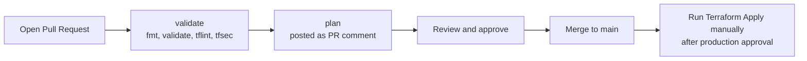

# CI/CD

Infrastructure changes go through a pull request. GitHub Actions authenticates to AWS with **OIDC**, so no long-lived AWS keys are stored in GitHub.

| Workflow | Trigger | What it does |
|---|---|---|
| `terraform-plan.yml` | Pull request to `main` | Runs the schema tests, `fmt -check`, the module and script tests (`terraform test`), `validate` (all layers), `tflint`, `tfsec`, then plans every layer in order and posts (or updates) one PR comment with a section per layer. Layers whose upstream layers are not deployed yet are reported as skipped. Uses the read-only **plan role**. |
| `terraform-apply.yml` | Manual (`workflow_dispatch`, input `env_name`, default `demo`) | Plans and applies each layer in order (`network`, `compute`, `workloads`, `edge`) in the `production` environment. Must run from `main` and needs `production` approval. Merging does not deploy. Uses the **apply role**. |
| `terraform-destroy.yml` | Manual (`workflow_dispatch`, inputs `confirm` and `env_name`) | Destroys the layers in reverse order (`edge`, `workloads`, `compute`, `network`). Requires typing `destroy`, running from `main`, and `production` approval. Each layer is retried up to three times, because some deletions fail once while AWS finishes an earlier deletion asynchronously. The NLB module also waits (`deregistration_wait`, 60s by default) between removing the ALB from its target group and the deletion of the ALB listener, because the listener cannot be deleted while the deregistration is still in progress. |

All layers run as steps of a single job, so one `production` approval covers the whole apply or destroy. (The apply role only trusts jobs in the `production` environment, so one job per layer would need one approval per layer.)

## One-time setup

> **Immutable OIDC subject:** newer GitHub repositories send an OIDC subject that includes numeric IDs (`repo:<owner>@<owner-id>/<repo>@<repo-id>`), and then the CI roles reject the login with `Not authorized to perform sts:AssumeRoleWithWebIdentity`. Check with `gh api repos/<owner>/<repo>/actions/oidc/customization/sub` and, if it shows a `sub_claim_prefix`, pass it to bootstrap:
> `terraform apply -var="github_repo=..." -var="github_oidc_subject_prefix=<sub_claim_prefix>"` (or `make bootstrap GITHUB_REPO=... OIDC_SUB_PREFIX=...`).

1. Run `bootstrap/` locally (see [Quick Start](../README.md#quick-start)) and note the three outputs.
2. In **Settings → Secrets and variables → Actions**, add:

   **Variables** (not sensitive):

   | Variable | Value |
   |---|---|
   | `AWS_REGION` | e.g. `ap-northeast-1`. Used to log in to AWS; must match `common.region` in `values.yaml` |
   | `DOMAIN_NAME` | *(optional)* your Route 53 zone, e.g. `example.com` |
   | `RECORD_NAME` | *(optional)* e.g. `demo` (defaults to `demo`) |

   **Secrets** (they contain your AWS account ID; this repository is public and the workflow logs are visible to everyone, so secrets are masked in the logs):

   | Secret | Value |
   |---|---|
   | `AWS_ACCOUNT_ID` | Your 12-digit AWS account ID. Referenced by the workflows so it is masked everywhere in the logs, and removed from the plan comment on the PR |
   | `AWS_PLAN_ROLE_ARN` | `plan_role_arn` output |
   | `AWS_APPLY_ROLE_ARN` | `apply_role_arn` output |
   | `EKS_ADMIN_PRINCIPAL_ARNS` | *(optional)* JSON list of IAM users/roles that get cluster-admin on EKS, e.g. `["arn:aws:iam::123456789012:user/your-user"]`. Without it, only the CI roles can see Kubernetes resources (for example in the EKS console). |

3. In **Settings → Environments**, create `production`, add **Required reviewers**, and restrict **Deployment branches** to `main`.
4. In **Settings → Branches**, protect `main` with a branch protection rule:
   - require a pull request before merging (0 required approvals when you work alone, because you cannot approve your own pull request),
   - require the `validate` and `plan` status checks to pass (the workflow runs on every pull request, so these checks always exist),
   - do not allow force pushes or deletion of the branch,
   - leave **Require review from Code Owners** off while there is a single maintainer: `.github/CODEOWNERS` then only requests reviews. Nobody can approve their own pull request, so with one owner the requirement would block every merge. Turn it on when a second account or team owns some paths,
   - **include administrators** ("Do not allow bypassing the above settings"). Without it the owner can still push directly to `main`; GitHub only prints a warning. If CI itself is broken, temporarily relax the rule in the settings to fix it.

## Security model

- The **plan role** can only be assumed by `pull_request` jobs. It has read-only access to AWS (`ReadOnlyAccess`), can read the Terraform state (only the keys under `aws-multi-vpc/`), and can write **only the lock files** (`*.tflock`) of the state bucket, never the state itself. A pull request runs the workflow of its own branch, so anyone who can push a branch can run commands with this role; that is why it must not be able to change the state. What remains possible is creating a fake lock file, which blocks an apply until it is deleted (a problem of availability, not of integrity). The bucket is also versioned, and old versions are kept for 90 days.
- The **apply role** can only be assumed by jobs running in the `production` environment.
- The demo apply role uses `AdministratorAccess` for simplicity. See [From demo to production: the apply role](#from-demo-to-production-the-apply-role) for how to replace it.
- Plan comments only work for pull requests from the same repository (forks do not receive OIDC tokens).

## From demo to production: the apply role

What protects the apply role today is **who can assume it**, not what it can do:

- No long-lived AWS keys exist in GitHub. Jobs get short-lived credentials through OIDC.
- The apply role trusts only OIDC tokens whose subject is the `production` environment of this repository. That environment is limited to `main` and needs an approval, so a pull request or another branch cannot obtain the role.
- The plan role is read-only (`ReadOnlyAccess`, plus write access to the state lock files only) and is only assumed by `pull_request` jobs.

What it can do once assumed is **everything** (`AdministratorAccess`). For real use, replace that policy. A reasonable way to do it:

1. **Start from what this code touches:** EC2 and VPC (VPC, subnets, route tables, peering, security groups, instances, launch templates), Elastic Load Balancing (ALB, NLB, target groups, listeners), Auto Scaling (target group attachment), EKS (cluster, node group, access entries), IAM (the EKS cluster and node roles), S3 (the assets bucket, and the state bucket), and optionally Route 53.
2. **Generate, then review:** run an apply with the broad role, let IAM Access Analyzer generate a policy from the CloudTrail events, and remove what you do not need.
3. **Scope by resource:** limit IAM actions to roles named `<name>-*`, S3 actions to the `<name>-assets-*` bucket and to the state key prefix `aws-multi-vpc/<environment>/*`, and use `aws:RequestedRegion` to pin the region.
4. **Prevent privilege escalation:** allow `iam:PassRole` only for the EKS roles and only `iam:PassedToService` EKS/EC2, and require a permissions boundary (`iam:PermissionsBoundary`) on every role that Terraform creates.
5. **One role per layer:** `network`, `compute`, `workloads` and `edge` need very different permissions (only `compute` needs IAM, only `edge` needs Route 53), and each can be limited to its own state key.
6. **Keep the trust policy** as it is, and keep a separate approval for `destroy`.
7. **Encrypt the state bucket with a customer managed KMS key** instead of SSE-S3. It gives you a key policy and an audit trail of every use of the key. It costs about US$1 per month, and every role that reads or writes the state (the plan role, the apply role, people) then also needs access to the key. The security scanner (tfsec) warns about this; the warning is ignored on purpose in `bootstrap/main.tf` and this is the reason.

None of this is implemented here; it is the plan for turning the demo into something you would run for real.

## Releases

A release is a git tag `vMAJOR.MINOR.PATCH` on `main`. An environment pins one with `common.platform_version` (see [Platform versions](configuration.md#platform-versions)).

1. Merge what should be in the release, and wait for the checks on `main`.
2. Create the release from `main`: `gh release create v1.2.0 --target main --generate-notes` (or in the GitHub UI). Use a new tag every time; never move or delete one that an environment may pin.
3. Promote: a pull request that sets `platform_version: v1.2.0` in `envs/<environment>/values.yaml`. Its plan comment shows what the upgrade does to that environment. `values.yaml` is owned by the platform (CODEOWNERS), so the platform owner reviews it.

**Protect the tags.** The apply role runs the code of the pinned tag, so whoever can move a tag can change what runs with that role. In **Settings → Rules → Rulesets** add a tag ruleset for `v*` (enforcement active, no bypass) with the rules **Restrict updates**, **Restrict deletions** and **Block force pushes**: a published version can then not be moved or removed (the repository has one named `protect release tags`). To also limit who can *create* a version tag, add **Restrict creations** and list the maintainers' role as a bypass actor. The workflows do not check the ruleset.

The first release must contain the `platform_version` support itself: an environment cannot pin an older version, because that code does not know the setting and the schema of that time would reject it.

## Known caveats

- **Plans of downstream layers:** a layer reads the *applied* values (SSM parameters) of the layers before it. On a fresh account only `network` can be planned, and a pull request that changes an upstream output and its consumer is planned against the old upstream values.
- **Reading Kubernetes resources in `plan`:** once the cluster exists, grant the plan role read access via an EKS access entry (`AmazonEKSViewPolicy`), otherwise `plan` fails on Kubernetes resources.
- **Apply re-plans:** `apply` runs a fresh plan when you trigger it, so the result can differ from the PR comment if the infrastructure changed in between.
- **Drift between `main` and AWS:** because apply is manual, merged changes are not deployed until you run the workflow.
